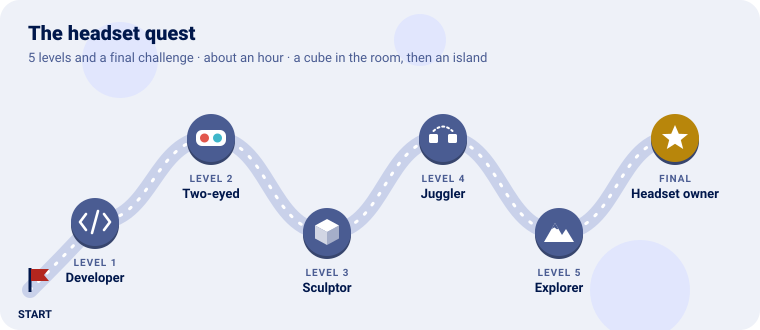

# The headset quest

Put a Go program in a Meta Quest 3, one level at a time. Each level teaches one piece of Go for
Meta Quest and ends with a package (`.apk`) you install on the headset.



We start by letting the computer talk to the headset, then paint each eye a colour of its own, put
a cube in the room that stays where it is however you move, give each hand a cube of its own, walk
an island with the sticks (and grow into a giant over it), and finally make a program of your own
and share it.

> 🚧 **Nothing here has run on a headset yet.** Every level builds into a package, but the
> checkpoints describe what the program is written to do, not what was seen. If a checkpoint does
> not come true, [what is where](3-what-is-where.md#what-was-checked) says what was and was not
> checked, and the log (level 1) says why.

---

Every level has the same shape: **the idea** (explained with something from everyday life), **the
code**, a **checkpoint** to know it works, and an optional **bonus**.

---

## Before you start

You need:

| | Why | Where |
|---|---|---|
| **Go** 1.25 or later | The compiler; it builds for Android itself | [go.dev](https://go.dev/dl/) |
| **The Android SDK**: build tools and a platform | `aapt2`, `zipalign` and `apksigner` make the package; the platform's `android.jar` is what its manifest is checked against | Android Studio's SDK manager, or `sdkmanager "build-tools;36.0.0" "platforms;android-37"` |
| **The Android NDK** | Its `clang` compiles the C parts of Go Renderer's `android` and `openxr` | `sdkmanager "ndk;29.0.14206865"` (any recent one) |
| **adb** | Installs and starts the package, and reads its log | `sdkmanager platform-tools` |
| **A Meta Quest 3** (or 3S) and a USB-C cable | Where it runs | |

`tools/build-apk.sh` finds the SDK in `ANDROID_HOME` and the NDK in `ANDROID_NDK_HOME` (or in
Homebrew's `android-commandlinetools`, on a Mac).

Clone Go for Meta Quest and Go Renderer side by side; until Go Renderer releases its headset pieces,
this repository builds against the checkout next to it:

```sh
git clone https://github.com/akrck02/go-renderer
git clone https://github.com/akrck02/go-meta-quest
cd go-meta-quest
```

Every program file starts with `//go:build android`: these programs only build for the headset.

---

## Level 1 · The Developer

| Mission | Pieces | Time |
|---|---|---|
| The headset in developer mode, seen by the computer, and the OpenXR loader downloaded | `adb devices`, `tools/fetch-loader.sh` | 15 min |

#### The idea

A headset is a **locked room**: it runs what its store sells. **Developer mode** is the key the
maker gives programmers: with it, the headset accepts packages from a computer over the cable.

The program will not talk to the headset's tracking directly. It talks to **OpenXR**, a standard
many headsets share, through a small library from Khronos (the group behind OpenGL), the
**loader**: it finds the headset's own OpenXR (its *runtime*) and passes everything on. The loader
goes inside every package.

#### Do it

1. Make yourself a developer in Meta's developer site (an organisation of your own is enough).
2. In the **Meta Horizon** app on your phone: the headset › *Headset settings* › *Developer mode*, on.
3. Connect the headset with the cable, put it on, and **allow USB debugging** for this computer.
4. On the computer:

```sh
adb devices                 # the headset, as "device" (not "unauthorized")
tools/fetch-loader.sh       # the newest OpenXR loader from Maven Central
```

`fetch-loader.sh` reads which version is newest, downloads Khronos's
`openxr_loader_for_android`, and keeps its arm64 library in `third_party/openxr-loader/` (not
committed: each clone fetches its own).

#### Checkpoint

`adb devices` lists the headset as `device`, and `third_party/openxr-loader/arm64-v8a/libopenxr_loader.so`
exists.

#### Bonus (optional): the headset's log

<details>
<summary>🔓 Show the solution</summary>

<pre><code>adb logcat -s Go OpenXR</code></pre>

What a Go program prints (and a crash's report) arrives under the tag `Go`; the headset's OpenXR
says what it thinks of a program under `OpenXR`. `tools/install.sh` opens this log after starting a
program.

</details>


---

## Level 2 · The Two-eyed

| Mission | Pieces | Time |
|---|---|---|
| Each eye a colour of its own, changing slowly | `app.Run`, `frame.Eyes`, `gles.Functions` | 5 min |

#### The idea

A headset is **two screens**, one in front of each eye, and the program draws a picture for each,
72 times a second. The runtime hands the program, every frame, a **framebuffer for each eye**: the
picture it will show there. Here each picture is only cleared to a colour, the simplest drawing
there is, so that if it works, everything under it works: the package, the loader, the session, the
pictures.

The colours go round the colour wheel, the right eye half a turn behind the left: red in one eye,
cyan in the other.

#### Build it

The program is `cmd/clear` in this repository:

```go
//go:build android

package main

import (
	"log"

	"github.com/akrck02/go-meta-quest/app"
	"github.com/akrck02/go-renderer/gles"
)

func main() {
	seconds := 0.0
	err := app.Run(app.Options{ApplicationName: "Clear"}, func(frame app.Frame) bool {
		seconds += frame.Seconds // the time since the last frame
		if !frame.ShouldRender { // the runtime will not show this frame: draw nothing
			return true
		}
		for index, eye := range frame.Eyes {
			red, green, blue := eyeColour(index, seconds) // in cmd/clear/colours.go
			functions := frame.Functions
			functions.BindFramebuffer(gles.FramebufferTarget, eye.Target)
			functions.SetViewport(0, 0, eye.Width, eye.Height)
			functions.SetClearColor(red, green, blue, 1)
			functions.Clear(gles.ColorBufferBit | gles.DepthBufferBit)
		}
		return true // false would end the program
	})
	if err != nil {
		log.Fatal(err)
	}
}
```

```sh
tools/build-apk.sh ./cmd/clear     # build/clear.apk
tools/install.sh build/clear.apk   # installs, starts it, and shows its log
```

#### Checkpoint

Put the headset on: each eye sees a plain colour, a different one, both slowly changing. Close one
eye, then the other. The headset's button with its logo brings the system's menu; choosing to
leave ends the program.

#### Bonus (optional): the same colour in both eyes

<details>
<summary>🔓 Show the solution</summary>

<pre><code>red, green, blue := eyeColour(0, seconds) // the left eye's, for both</code></pre>

Two different colours in the eyes are uncomfortable to look at for long; one colour is calm.

</details>


---

## Level 3 · The Sculptor

| Mission | Pieces | Time |
|---|---|---|
| A lit cube, standing still in the room as you move round it | `scene.Scene`, `camera.Rig`, `gles.SceneRenderer.DrawViews` | 10 min |

#### The idea

On a screen, the camera is where the program says. In a headset, **the camera is your head**: the
runtime says, every frame, where each eye is and which way it looks, in metres, in the room. The
program draws the scene from there, so a cube put 1.5 m ahead of you stays 1.5 m from where it
was, whatever you do: lean in, walk round it, look away and back.

The room's floor is where the headset says it is, so the cube can stand at eye height. A **rig**
(`camera.Rig`) is where the room is in the scene: here the scene is the room, one unit a metre.

Each eye looks through a slightly lopsided window (it sees further to its own side than towards the
nose), so each has its own projection. Go Renderer plans the frame once for both (which meshes are seen) and
draws it twice.

#### Build it

The program is `cmd/cube`; here is its heart (the cube's mesh and placing it are in
`cmd/cube/world.go`):

```go
	made := newWorld() // a scene with a 30 cm cube, hidden until placed
	rig := camera.Rig{} // the room is the scene: one metre a unit
	var renderer *gles.SceneRenderer
	views := make([]gles.View, 2)
	poses := make([]graphics.Pose, 2)
	fields := make([]graphics.FieldOfView, 2)

	err := app.Run(app.Options{ApplicationName: "Cube"}, func(frame app.Frame) bool {
		if !frame.ShouldRender {
			return true
		}
		made.place(rig, frame.Head, frame.HeadTracked) // once the head is tracked: 1.5 m ahead, at its height
		if renderer == nil {
			created, err := gles.NewSceneRenderer(frame.Functions, overlay.Fonts{})
			if err != nil {
				log.Print(err)
				return false
			}
			renderer = created
		}
		// The eyes' pictures turn colour to sRGB themselves: the renderer writes linear colour.
		renderer.LinearOutput = frame.SRGB
		for index, eye := range frame.Eyes {
			poses[index], fields[index] = eye.Pose, eye.Field
			views[index] = gles.View{Target: eye.Target, Width: eye.Width, Height: eye.Height,
				View:       rig.EyeView(eye.Pose),
				Projection: graphics.PerspectiveFromFieldOfView(eye.Field, near, far),
				Eye:        rig.EyePosition(eye.Pose)}
		}
		covering, aspect := camera.CoveringLens(rig, poses, fields, near, far) // one plan for both eyes
		renderer.DrawViews(made.scene, covering, aspect, views)
		return true
	})
```

```sh
tools/build-apk.sh ./cmd/cube
tools/install.sh build/cube.apk
```

#### Checkpoint

An orange cube, the size of a box you could hold in both arms, an arm and a half ahead of you at
eye height, turned so you see three faces, each shaded differently. Walk round it: it stays where
it is, and you see its back. Its colours look like the colour, not washed out (that would be the
colour turned to sRGB twice).

#### Bonus (optional): bring the cube back

<details>
<summary>🔓 Show the solution</summary>

A cube left behind across the room can come back in front of you with the **A** button:

<pre><code>if frame.Input.PadPressed(input.PadA) {
	made.placed = false // place puts it in front of the head again
}
made.place(rig, frame.Head, frame.HeadTracked)</code></pre>

The controllers are a game pad in `frame.Input`, as on a desktop: A, B, X and Y are the pad's
buttons, the sticks its sticks.

</details>


---

## Level 4 · The Juggler

| Mission | Pieces | Time |
|---|---|---|
| A small cube in each hand | `frame.Hands`, `Grip`, `Tracked`, `rig.Place` | 5 min |

#### The idea

The controllers are tracked like the head: each has a **pose**, where it is held (`Grip`) and where
it points (`Aim`). A thing the program puts at a hand's grip pose moves with the hand. A controller
the headset cannot see (behind your back, put down, asleep) is not **tracked**, and its cube hides.

#### Build it

It is already in `cmd/cube`: at the top of each frame,

```go
		made.follow(rig, [2]graphics.Pose{frame.Hands[app.LeftHand].Grip, frame.Hands[app.RightHand].Grip},
			[2]bool{frame.Hands[app.LeftHand].Tracked, frame.Hands[app.RightHand].Tracked})
```

and `follow` (in `world.go`) puts each 5 cm cube at its hand with `rig.Place(grip)`, or hides it.

#### Checkpoint

A blue cube in your left hand and a green one in your right, inside the controllers' grips. Put a
controller behind your back: its cube goes. Open the system's menu: the cubes stay drawn, but the
program does not have the controllers until you come back (`frame.Focused` is false).

#### Bonus (optional): squeeze to grow

<details>
<summary>🔓 Show the solution</summary>

Give `follow` the grip buttons too (a `[2]float32` of `frame.Hands[index].Squeeze`, 0 to 1), and
scale each hand's cube by its own:

<pre><code>grow := 1 + 2*squeeze[index]
hand.Transform = rig.Place(grips[index]).Multiply(graphics.Scale(graphics.Vector{grow, grow, grow, 0}))</code></pre>

</details>


---

## Level 5 · The Explorer

| Mission | Pieces | Time |
|---|---|---|
| Stand on an island, walk it with the sticks, and grow into a giant over it | `sample.Island()`, `camera.RigWalk`, `rig.Scale`, `world.GroundHeight` | 15 min |

#### The idea

Your room is small; the island is not. You can walk a few steps in the room, and the headset moves
your eyes on the island just as far. To go further, the program moves **the room itself** on the
island: that is the rig again (level 3). The left stick slides the room the way you look, so you
glide over the ground; the right stick turns the room in steps around you. Never smoothly: a view
that turns while your head does not makes many people queasy, a quick step does not.

The program never moves your **head**. The headset says where it is, and the picture must follow it
exactly, or the world swims.

Two more things make it feel like a place. The room's floor follows the **ground under your head**,
so you climb a hill as you walk up it (`world.GroundHeight`). And the rig's **scale** says how many
of the island's units a metre of your room is: at 1 you are a person among the houses; at 20 you
are a giant, the island is a model the size of a room, and your hands' cubes are twenty times
bigger too. Switching keeps your head over the same spot of the ground, so you grow where you stand.

#### Build it

The program is `cmd/explorer`. Its world (`explorer.go`) is Go Renderer's sample island, the rig,
a `camera.RigWalk` on the island's ground, and the two hand cubes of level 4:

```go
func newExplorer(world *scene.Scene) *explorer {
	made := &explorer{world: world, rig: startRig(world), // on the ground, south of the square
		views: make([]gles.View, 2), poses: make([]graphics.Pose, 2), fields: make([]graphics.FieldOfView, 2)}
	made.walk = camera.RigWalk{Ground: world.GroundHeight} // the floor follows the ground
	// … a cube for each hand, as in cmd/cube
	return made
}

// steer: Y or B switches between a person and a giant; the sticks walk and turn.
func (made *explorer) steer(state *input.State, seconds float64, head graphics.Pose, headTracked bool) {
	if headTracked && (state.PadPressed(input.PadY) || state.PadPressed(input.PadB)) {
		made.rig = rescale(made.rig, head, otherScale(made.rig.Scale), made.walk.Ground)
	}
	made.walk.Update(state, seconds, head, &made.rig)
}
```

`startRig` and `rescale` are in `places.go`, plain Go with tests: the first finds the village
square among the island's nodes and puts the room's floor on the ground twelve metres south of it,
facing it; the second changes the scale and moves the room so the head stays over the same point.

Every frame, `main.go` steers, follows the hands and draws both eyes as in level 3. The views are
made into the same slices each frame, so a frame makes no new garbage for the collector to stop
for; at 72 frames a second, a pause shows. The near plane grows with the scale: a giant's hands
are twenty times further away in the island's units.

```sh
tools/build-apk.sh ./cmd/explorer
tools/install.sh build/explorer.apk
```

#### Checkpoint

You stand a short walk south of a paved square, in an afternoon light: the square ahead, the houses
behind it, trees and the hill around, the sea and its fog far off. Push the left stick: you glide
the way you look, up and down the slopes. Flick the right stick: the island turns a step around
you. Walk in the room: you walk on the island. Press **Y** (or **B**): you are a giant, the island
at your feet, still over the same spot; press it again to be yourself.

#### Bonus (optional): a faster giant

<details>
<summary>🔓 Show the solution</summary>

A giant already walks twenty times further for the same push (the speed is in the room's metres).
To make a person walk faster too, set the speed in metres a second:

<pre><code>made.walk = camera.RigWalk{Ground: world.GroundHeight, SpeedMetres: 3}</code></pre>

`TurnRadians` sets the step of a turn the same way (π/6, a twelfth of a turn, when it is 0).

</details>


---

## Final challenge · Headset owner

A program of your own, in a module of your own, in the headset, and shared with the notices it must
carry.

> **Hint:** `tools/build-apk.sh` builds from the folder it is run in, so it works for any module.
> Until Go Renderer releases its headset pieces, your module points at the two checkouts with
> `replace` lines.

<details>
<summary>🔓 Show the solution</summary>

1. Beside the two checkouts:

   <pre><code>mkdir headset && cd headset
   go mod init example.com/headset
   go mod edit -require=github.com/akrck02/go-meta-quest@v0.0.0 \
       -replace=github.com/akrck02/go-meta-quest=../go-meta-quest \
       -replace=github.com/akrck02/go-renderer=../go-renderer</code></pre>

2. Copy `cmd/cube` into `./mine`, change the cube's colour in `world.go`, and `go mod tidy`.
3. `../go-meta-quest/tools/build-apk.sh ./mine`, then `../go-meta-quest/tools/install.sh build/mine.apk`.
4. To share `build/mine.apk`, put Go for Meta Quest's [THIRD_PARTY_NOTICES.md](../THIRD_PARTY_NOTICES.md)
   next to it: the package carries the Go runtime and Khronos's OpenXR loader.

</details>


---

## Well done


You built Go for a headset: a picture in each eye, a cube that stays in the room, the
controllers in your hands, and an island to walk, as a person or as a giant.

### Ideas to keep going

| Idea | Difficulty | Hint |
|---|---|---|
| A cube that spins | ⭐ | Turn `made.cube.Transform` a little every frame by `frame.Seconds`, and set the node's `Moving` |
| The island at night | ⭐ | `sample.Night()` instead of `sample.Island()` |
| A scale in between | ⭐⭐ | A third size on X, say 5: the island the size of a house |
| Jump to a place | ⭐⭐ | On A, move `rig.Position` so the head stands over another node of the island (`nodePosition`), the floor on its ground |

## Troubleshooting

| You see | Why, and what to do |
|---|---|
| `adb devices` lists the headset as `unauthorized` | Put it on and allow USB debugging for this computer |
| The program opens in a flat window | The package lacks `com.oculus.intent.category.VR`, or it was built from another manifest: build it with `tools/build-apk.sh` |
| It closes at once; the log says the loader is missing | `libopenxr_loader.so` is not in the package: run `tools/fetch-loader.sh` and build again |
| `build constraints exclude all Go files`, or the program prints that it runs on a Meta Quest | These programs build for Android only: use `tools/build-apk.sh`, not `go build` |
| Colours look washed out, too light | The colour was turned to sRGB twice: set `renderer.LinearOutput = frame.SRGB` |
| On the island, you stand inside the ground or float over it | The floor follows the ground under the head, and the head stands as high above it as it is above the room's floor: check the room's floor in the headset's settings (a guardian drawn at the wrong height puts the floor there too) |
| The cube is on the floor, or above you | It is placed at the head's height on the first frame shown: start the program standing (or sitting) as you mean to look at it, or bring it back (level 3's bonus) |

---

[← All the documentation](1-overview.md)
